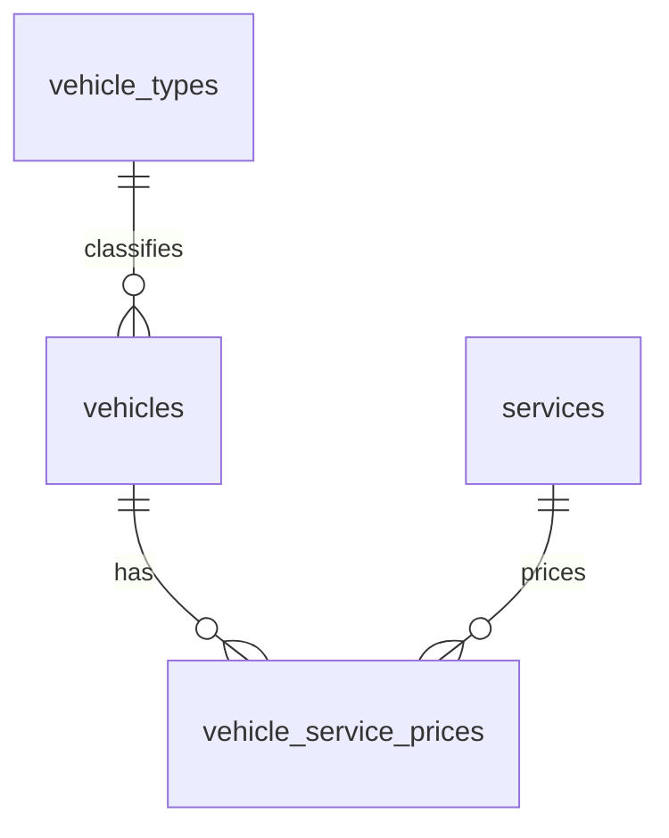

# Current database design

Migration `009-booking-checkout.sql` adds `bookings` (customer/route details, integer-cent totals, quote snapshots and Stripe state), `booking_add_ons` (names, quantities and price snapshots) and `stripe_webhook_events` (processed event IDs). A persistent sequence generates booking numbers using the Singapore date. Checkout attempts have unique idempotency keys and Stripe sessions. Booking totals are constrained to equal vehicle, distance and add-on amounts. See [checkout API](checkout-api.md).

Migration `008-distance-pricing.sql` adds `distance_pricing_rules`: kilometer boundaries with explicit inclusive/exclusive flags, decimal surcharges, currency, contact-support status, visibility and timestamps. A generated PostgreSQL numeric range and GiST exclusion constraint prevent overlapping active brackets. No extension is needed. Exact 35 km belongs to the final priced bracket, while greater distances belong to the unbounded contact-support rule. Admin endpoints manage rules; see [quote API](add-ons-api.md).

Migration `007-add-ons.sql` adds the independent `add_ons` catalog with configurable codes, names, descriptions, pricing types (`FIXED`/`PER_STOP`), decimal prices, currencies, statuses and timestamps. It reuses the update timestamp trigger and seeds five initial SGD options. Quotes read this table together with currently eligible vehicle/service prices. No booking tables are created in this stage. See [add-ons and quotes](add-ons-api.md).

Apply the upgrade with `npm run db:migrate`. Migration `005-catalog-redesign.sql` transforms the previous schema in one transaction. Existing vehicle IDs, service codes, price amounts and catalog IDs are preserved. Migrations 001–004 remain historical files; do not run them individually against an upgraded database.



| Table | Columns |
| --- | --- |
| `vehicle_types` | id, name, description |
| `vehicles` | id, name, description, vehicle_type_id, passenger_capacity, luggage_capacity, image_url, status, created_at, updated_at |
| `services` | id, service_code, service_name, pricing_unit, status, sort_order |
| `vehicle_service_prices` | id, vehicle_id, service_id, price, currency, minimum_hours, valid_from, valid_to, status, created_at, updated_at, is_from |

Status is `active` or `inactive`. Pricing unit is `trip` or `hour`. Vehicle type and capacities are nullable until confirmed by an administrator. Images are optional HTTP(S) URLs. `updated_at` is maintained by database triggers. `price` is exact NUMERIC(12,2), not floating-point storage. Currency belongs to each price. `is_from` preserves “from” rates, and `sort_order` preserves category display order.

Each vehicle/service pair has one price row, protected by a unique constraint. Its ID is the booking `catalogId`. Admin PUT updates that row without changing its ID. This model does not store multiple historical or future rates for the same pair. Booking records must snapshot the agreed amount and currency instead of treating this mutable row as an immutable quote.

`valid_from` defaults to the current timestamp. `valid_to` is optional and must be later than `valid_from`. The interval is inclusive at the start and exclusive at the end. Public price queries require active price and service statuses and a currently valid interval. Inactive vehicles are hidden from public lists and recommendations. No live booking inventory is implemented.

## Admin APIs

- `GET /api/v1/vehicle-types` lists vehicle types.
- `POST /api/v1/vehicle-types` accepts `{"name":"Executive MPV","description":"Premium people carrier"}`.
- `PATCH /api/v1/vehicle-types/:id` updates name/description.
- Vehicle POST/PATCH accepts `vehicleTypeId`, `imageUrl` and `status`, alongside existing fields.
- Service POST/PATCH accepts `status`. Existing JSON names `code`, `name`, and `unit` map to SQL `service_code`, `service_name`, and `pricing_unit`; service responses also include numeric `id`.
- Price PUT accepts `amount`, `currency`, `validFrom`, `validTo`, `status`, `isFrom` and `minimumHours`. Existing prices retain their currency when omitted. For a new price, currency may be inferred only when the vehicle's current prices all use one currency; otherwise it is required.

Example price request:

```json
{
  "amount": 95,
  "currency": "SGD",
  "status": "active",
  "validFrom": "2026-10-02T00:00:00Z",
  "validTo": null,
  "isFrom": false,
  "minimumHours": null
}
```

PUT replaces the full price settings; omitted dates reset to now/no expiry and omitted status defaults to active. A future/inactive price disappears from the public vehicle prices until eligible. GET catalog lookup returns 404 for prices that are not currently eligible.

API vehicle responses now include `vehicleTypeId`, `vehicleType`, `imageUrl`, `status` and `updatedAt`. Prices include `serviceId`, `currency`, `validFrom`, `validTo` and `status`, alongside existing fields. The compatibility `isActive` field is derived from status. Top-level vehicle currency is returned only when all visible rates share one currency; use each price's currency when displaying it.

Grant the runtime role SELECT/INSERT/UPDATE on the four tables and USAGE on the vehicle, vehicle-type, service and price identity sequences. Use a separate schema-owning migration role. Back up the database before applying a deployed schema migration.
